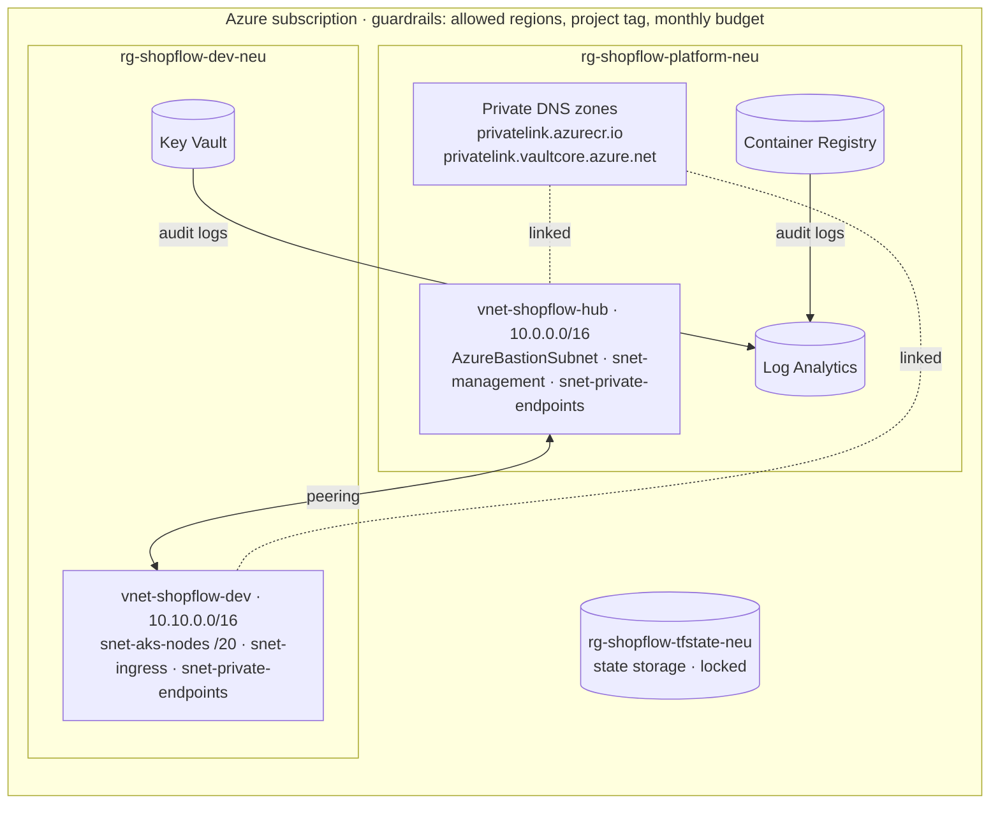

# shopflow-infra


Terraform for the Azure landing zone that runs [ShopFlow](https://github.com/kirthikesh/shopflow-app),
an event-driven microservices store. Hub-and-spoke networking, private DNS, a container registry,
centralised logging, and cost and policy guardrails, built as small reusable modules in separate,
independently deployable layers.

> **Status:** Phases 2–3 done: landing zone, AKS and Service Bus. `make aks-down` / `make aks-up` switch the paid compute off and on.

---

## Architecture



## Layers

Each layer has its own state file, so a change to dev can never touch shared resources.

| Layer | State | What it creates |
|---|---|---|
| `bootstrap/` | local | Storage account for remote state: Entra ID auth only, versioning, soft delete, delete lock |
| `platform/` | `platform.tfstate` | Hub VNet and NSGs, private DNS zones, ACR, Log Analytics, budget alerts, policy assignments |
| `envs/dev/` | `envs/dev.tfstate` | Spoke VNet peered to the hub, DNS links, Key Vault with RBAC and audit logging |

`envs/dev` reads the platform layer's outputs through `terraform_remote_state`, so nothing is copied by hand.

## Modules

| Module | Purpose |
|---|---|
| `hub-network` | Hub VNet, Bastion/management/private-endpoint subnets, NSGs |
| `spoke-network` | Environment VNet sized for AKS (CNI Overlay), NSGs, two-way peering to the hub |
| `private-dns` | Private DNS zones linked to any number of VNets |
| `container-registry` | ACR with admin user disabled, optional private endpoint, audit logs |
| `key-vault` | Key Vault with RBAC, optional private endpoint, audit logs |
| `log-analytics` | Workspace with retention and a daily ingestion cap |
| `budget` | Monthly budget with 50/80/100% actual and 100% forecast alerts |
| `policy-baseline` | Built-in Azure Policy: allowed locations (deny), resource group tag (audit) |

## Run it

Prerequisites: Terraform 1.9+, Azure CLI, and an Azure subscription.

```bash
az login
make check                      # confirms which subscription you're using

make bootstrap                  # once: creates the state storage account
cp platform/terraform.tfvars.example platform/terraform.tfvars   # add your email
make platform-apply             # hub, ACR, logging, budget, policy
make dev-apply                  # dev spoke and Key Vault
```

Tear down at the end of every session. The state account is kept, so `make up` brings everything back:

```bash
make down                       # destroys dev, then platform
make up                         # recreates both
```

Other commands: `make validate` (format check and validate every layer, no Azure access needed),
`make dev-plan`, `make help`.

## Jump box and Ansible

`management/` creates a Linux VM in the hub's management subnet; `ansible/` configures it. The same VM is the
**Azure DevOps self-hosted agent**, so pipelines run inside the private network.

| Role | What it does |
|---|---|
| `common` | Package updates, base tools, timezone, unattended security upgrades |
| `hardening` | SSH: keys only, no root, `AllowUsers`, validated with `sshd -t` before reload. ufw (deny all, rate-limited SSH), fail2ban, auditd, kernel sysctl hardening |
| `devtools` | Azure CLI, Terraform, kubectl, kubelogin, Helm, Docker, from vendor-signed apt repositories |
| `ado_agent` | Dedicated `azdo` user, agent version fetched from the org's API, registered unattended, runs under systemd. The PAT is only used to register and is revoked afterwards |

```bash
make jumpbox-up        # VM with SSH open to your IP only; auto-shutdown at 22:00
make ansible           # idempotent: a second run reports changed=0
ADO_ORG_URL=... ADO_PAT=... make ansible   # also registers the agent
make jumpbox-ssh
make jumpbox-down
```

The playbook passes `ansible-lint` at the **production** profile.

## Cost

Defaults are chosen to keep an idle landing zone at a few euros a month.

| Resource | Default | Approx. cost |
|---|---|---|
| VNets, subnets, NSGs, peering | — | Free (peering traffic is billed per GB) |
| Container Registry | Basic | ~€5 / month |
| Private DNS zones | 2 zones | ~€1 / month |
| Log Analytics | 0.5 GB/day cap | Pay per GB ingested |
| Key Vault | Standard | Per operation, cents |
| State storage | LRS | Cents |
| Private endpoints | Off | ~€7 / month each when on |
| ACR Premium (needed for private endpoint) | Off | ~€45 / month when on |

The budget alert emails at 50%, 80% and 100% of the monthly amount, and when the forecast says it will be exceeded.

## Design decisions

- **Hub and spoke.** Shared services and future connectivity (Bastion, VPN, firewall) live once in the hub. Each environment is an isolated spoke, so dev and prod can never reach each other directly.
- **No shared keys anywhere.** The state account has access keys disabled and Terraform authenticates with Entra ID. ACR has its admin user off. Key Vault uses RBAC instead of access policies.
- **Layered state.** Bootstrap, platform and each environment have separate state files and separate blast radius. Destroying dev cannot affect the registry or the hub.
- **Private endpoints behind a flag.** The modules support them fully, with DNS zones already in place. They're off by default because they need something inside the VNet (the Phase 4 jump box or the Phase 3 cluster) to be useful, and ACR's needs the Premium SKU.
- **AzureRM 5.x.** Resource providers are registered explicitly per layer, since 5.x no longer registers them automatically.
- **Guardrails from day one.** A budget and region policy exist before any workload does.
- **Tag policy in audit mode.** Azure creates some resource groups itself (Network Watcher, the AKS node group) without our tags, so denying untagged groups would break those.

## Problems I hit, and how I fixed them

| Problem | Cause | Fix |
|---|---|---|
| Ansible: `'timezone' is undefined` | `group_vars/` sat in the project root; Ansible only loads it next to the inventory or playbook (ansible-lint doesn't catch this) | Moved it to `ansible/inventory/group_vars/` |
| Azure DevOps API returned **203** with a sign-in page | `uri` with `user: ""` silently skips Basic auth, so the PAT was never sent | Built the `Authorization: Basic` header explicitly; isolated it by testing the token with `curl` first (200) |
| Azure DevOps sign-in kept failing (404/500) | Browser session confusion with a personal Microsoft account across directories | Created the organisation from a clean Incognito session |
| `AADSTS530035: Access has been blocked by security defaults` when Terraform read state | Security Defaults require MFA, and data-plane endpoints (Blob Storage, Key Vault) each need their own MFA-backed token | Re-authenticated per resource: `az login --scope https://storage.azure.com/.default`, and the same for `https://vault.azure.net` |
| Key Vault create timed out after 12 minutes on `GetCertificateContacts` | The vault was created through ARM, but the provider's follow-up read goes to the vault's data plane, which had no valid token | Logged in with the Key Vault scope; Terraform replaced the half-created vault cleanly on the next apply |
| `Invalid count argument` on diagnostic settings | `count = workspace_id == null ? 0 : 1` depends on an ID that only exists after apply | Replaced with an explicit `enable_diagnostics` boolean, which is known at plan time |
| `private_dns_zone_name` not accepted on DNS zone links | AzureRM 5.x links zones by ID instead of name and resource group | Switched to `private_dns_zone_id`, caught by `terraform validate` before anything was deployed |
| AKS create rejected: `Standard_D2s_v5 is not allowed in your subscription` | New pay-as-you-go subscriptions are limited to certain VM SKUs per region, separate from vCPU quota | Compared the allowed-SKU list with `az vm list-usage` quotas and chose `Standard_EC2ads_v5`, the cheapest size that was both allowed and had quota. The size is a variable, so no module change was needed |
| `az vm list-usage` returned nothing | `Microsoft.Compute` wasn't registered on the subscription | Registered it, and added it to the dev layer's explicit provider list |
| `TasksOperationsNotAllowed` from `az acr build` | ACR Tasks (cloud builds) are disabled for new subscriptions | Built with `docker buildx --platform linux/amd64` on an ARM Mac and pushed with `az acr login`; the cloud build path stays in the Makefile for when it's enabled |
| Apply looked frozen with no output | A fresh subscription registers each resource provider on first use, which takes minutes | Pre-registered providers with `az provider register --wait`, and declared them explicitly in each layer |

## Repository layout

```
shopflow-infra/
├── Makefile
├── bootstrap/          remote state storage (local state)
├── platform/           shared hub layer
├── envs/
│   └── dev/            dev spoke layer
└── modules/
    ├── hub-network/
    ├── spoke-network/
    ├── private-dns/
    ├── container-registry/
    ├── key-vault/
    ├── log-analytics/
    ├── budget/
    └── policy-baseline/
```

## Roadmap

- [x] Remote state with Entra ID auth
- [x] Hub-and-spoke network, private DNS, ACR, Log Analytics
- [x] Budget alerts and policy guardrails
- [x] AKS with Workload Identity, Entra ID RBAC, Cilium overlay, Container Insights (Phase 3)
- [x] Azure Service Bus Standard for the order flow (Phase 3)
- [ ] Make the AKS API fully private once the jump box exists (Phase 4)
- [x] Ansible-managed jump box and Azure DevOps self-hosted agent (Phase 4)
- [ ] Azure DevOps pipeline: `plan` on pull request, approval before `apply` (Phase 5)
- [ ] Prod spoke (`envs/prod`, 10.20.0.0/16)
